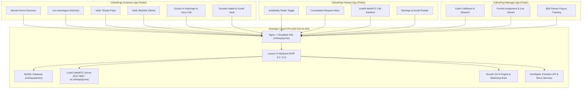
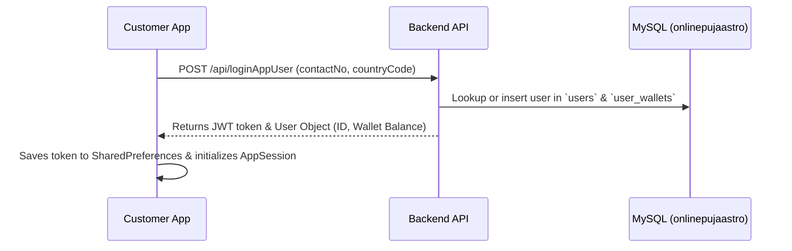
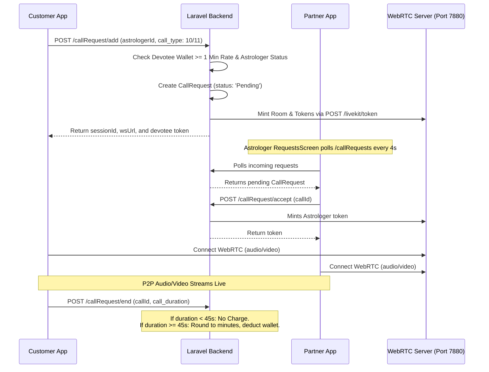
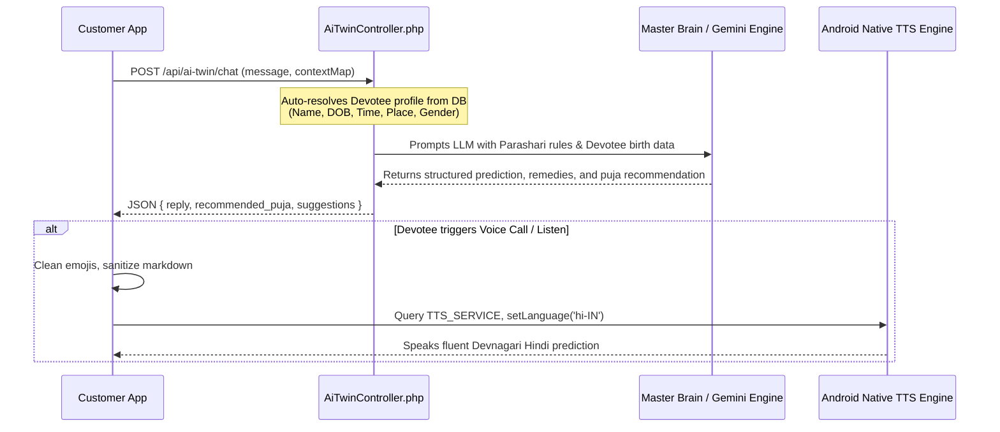
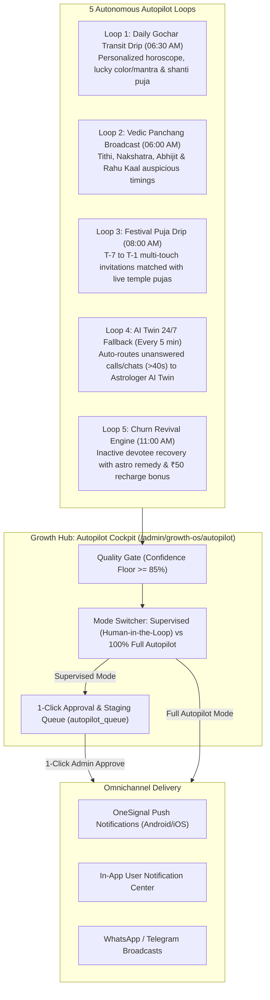
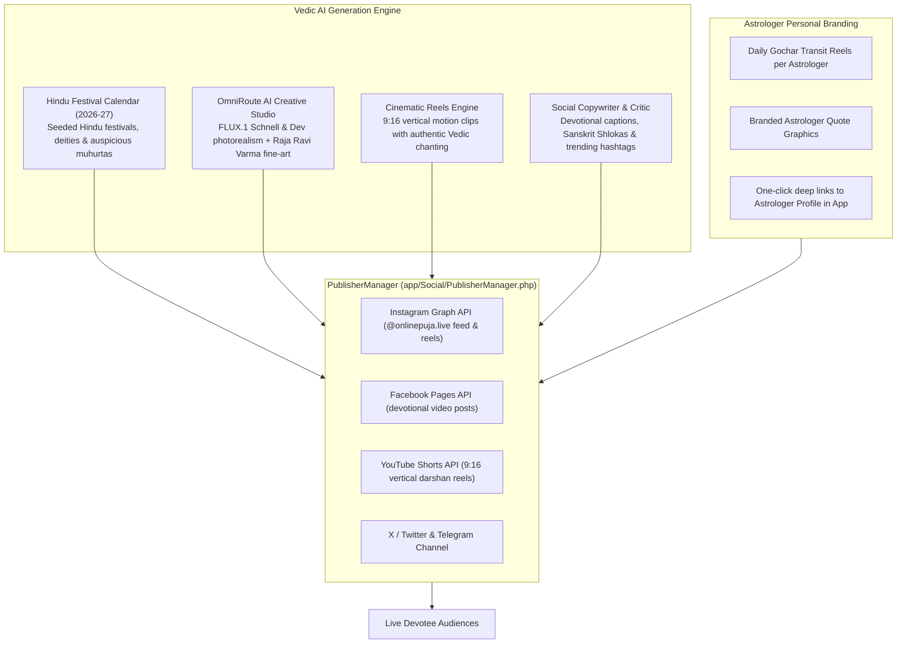
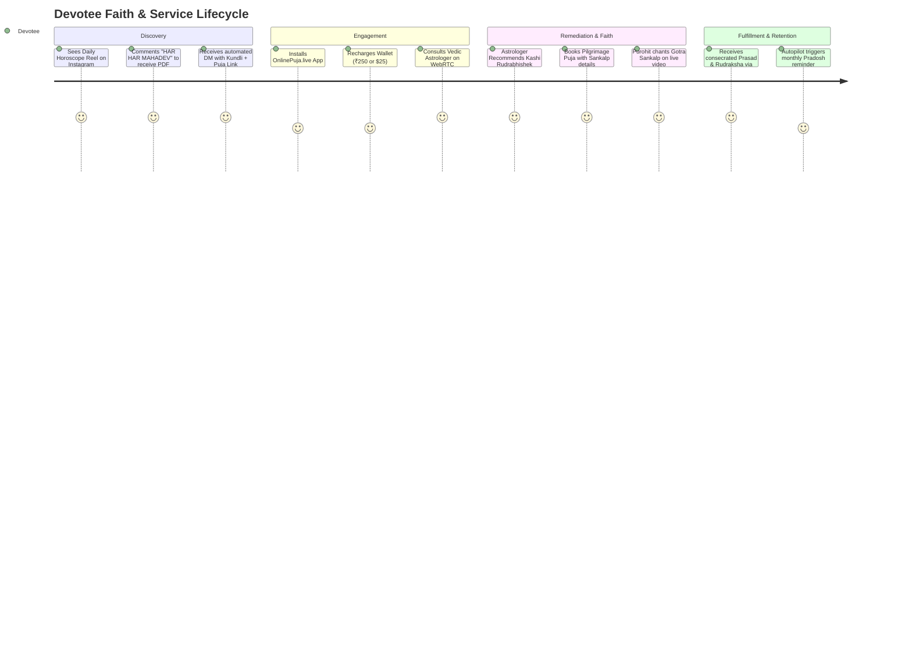
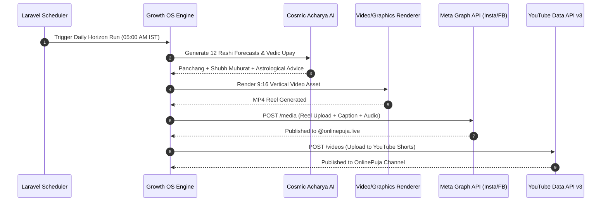
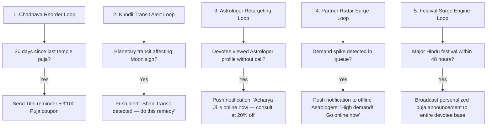

# 🕉️ Project OnlinePuja.live — Complete System Architecture, Flows, Gaps & Roadmap

> **Target Audience:** Any new AI Coding Assistant or Software Engineer taking over the project.  
> **Key Objective:** Provide an exhaustive, one-shot mental model of the entire ecosystem: Server, Backend APIs, Database, WebRTC, AI Engines, Flutter Client Apps, Billing, Known Bugs, Root Causes, and Pending Action Items.  
> **Last Updated:** October 22, 2026  
> **Production Host:** `https://onlinepuja.live`  
> **Master AI Onboarding Guide:** See [`AI_CONTEXT.md`](../AI_CONTEXT.md) in repository root for instant operational guidance.

---

## 1. 🌐 Executive Project Overview

**OnlinePuja.live** is a comprehensive Indian Spiritual, Devotional, and Astrological ecosystem designed for millions of Sanatan Dharma devotees worldwide. The platform integrates:
1. **Sacred Temple Pujas & Live Darshan**: Booking authentic Vedic rituals, Havans, and Prasad delivery from sacred pilgrimage centers (Varanasi, Ujjain, Somnath, Ayodhya).
2. **Live Astrologer Consultation**: Real-time 1-on-1 Audio and Video consultations between devotees and verified Vedic Astrologers, backed by wallet-based per-minute billing and WebRTC audio/video.
3. **Cosmic AI Astrologer (AI Twin & Voice Call)**: 24/7 intelligent LLM-powered astrological consultations with live Gochar, Parashari, and KP predictions, and full-screen Vedic AI Acharya voice calls.
4. **Vedic Bhandar (Sacred Store / E-Commerce)**: A consecrated store for certified Gemstones, Rudraksha, Sphatik Malas, Devalaya Idols, and Vedic literature, seamlessly payable via wallet balance.
5. **Growth AI OS & Autonomous Marketing Brain**: Multi-channel campaign orchestration, real-time banner synthesis (1200×630 & 1080×1080), 1080×1920 MP4 video reel generation, automatic SEO blog creation, and national B2B partner distribution.



---

## 2. 🖥️ Infrastructure & Deployment Topography

| Component | Specification / Location | Details |
| :--- | :--- | :--- |
| **Server IP** | `200.234.41.231` | Hostinger Cloud VPS running Ubuntu Linux. |
| **SSH Access** | `ssh root@200.234.41.231` | Root shell with public key / system access. |
| **Web Root** | `/home/onlinepujalive/htdocs/onlinepuja.live` | Laravel 10 codebase. |
| **Web Server** | Nginx Reverse Proxy + PHP-FPM 8.2 | Handles HTTPS with Cloudflare Origin SSL certificates. |
| **MySQL Database** | Host: `127.0.0.1:3306`, DB: `onlinepujaastro` | User: `opastro`, Pass: `l7wb8ciFmVHc2Qevy58XEVsU`. |
| **WebRTC Server** | LiveKit Server (`200.234.41.231:7880`) | Nginx WSS proxy: `wss://rtc.onlinepuja.live`. |
| **Public Downloads** | `/home/onlinepujalive/htdocs/onlinepuja.live/public/downloads/` | Houses compiled APKs for production distribution. |

### Public Download Mirrors
* Customer App: `https://onlinepuja.live/downloads/onlinepuja-customer-latest.apk`
* Astrologer App: `https://onlinepuja.live/downloads/onlinepuja-astrologer-release.apk`
* Partner Alias: `https://onlinepuja.live/downloads/onlinepuja-partner-latest.apk`

---

## 3. 📂 Repository & Codebase Structure

The mobile ecosystem is managed inside a unified Flutter monorepo at `d:\Dev\onlinepuja-live\apps`:

```
d:\Dev\onlinepuja-live\apps
├── onlinepuja-customer/          # Customer Devotee Flutter App (live.onlinepuja.app)
│   ├── lib/
│   │   ├── main.dart             # App entry point, session initialization
│   │   ├── app.dart              # MaterialApp, routing, theme binding
│   │   ├── state/app_session.dart# Devotee Auth, wallet, reactive user state
│   │   └── ui/
│   │       ├── screens/
│   │       │   ├── main_shell.dart         # 5-Tab Bottom Navigation Bar
│   │       │   ├── home/                   # ConsultHomeScreen, Hero Banners, Vedic Sanctum
│   │       │   ├── astrologer/             # AstrologersScreen, Live Filters, Astrologer Card
│   │       │   ├── puja/                   # PujaListScreen, PujaDetailScreen, Sankalp booking
│   │       │   ├── mall/                   # MallScreen (Vedic Bhandar), ProductDetailScreen
│   │       │   ├── cosmic_ai_screen.dart   # Vedic AI Chatbot, AI Swarm, Voice Call UI
│   │       │   ├── call/audio_call_screen.dart # LiveKit WebRTC Call Interface & Billing Timer
│   │       │   └── profile/wallet_screen.dart  # Devotee Wallet, Recharge UI
│   │       └── theme/customer_theme.dart   # Saffron & Cosmic Purple palette
│   └── android/app/src/main/AndroidManifest.xml
│
├── onlinepuja-astrologer/        # Astrologer Partner Flutter App (live.onlinepuja.astro)
│   ├── lib/
│   │   ├── main.dart             # Partner entry point
│   │   ├── state/app_session.dart# Partner Session, online status, astrologer ID
│   │   └── ui/screens/
│   │       ├── home/home_shell.dart        # Partner Dashboard & Earnings
│   │       ├── home/requests_screen.dart   # Real-time Call/Chat Request Inbox (4s Poller)
│   │       ├── home/availability_screen.dart # Go Online / Busy / Offline Radar
│   │       └── call/call_session_screen.dart # Partner LiveKit WebRTC Session
│
├── onlinepuja-manager/           # Operations, Temple & Purohit Dispatch App
│   ├── lib/
│   │   ├── main.dart             # Operations Admin entry point
│   │   └── ui/                   # Dispatch queue, Live darshan broadcaster, B2B tracker
│
└── shared/ (op_shared)           # Shared Core Foundation Package
    ├── lib/src/
    │   ├── api/api_client.dart   # HTTP REST Client with Bearer token injector
    │   ├── l10n/app_strings.dart # 15-Language Vedic Dictionary & LocaleManager
    │   ├── models/               # Astrologer, Puja, Product, User, Kundli models
    │   └── services/             # AstrologerApi, MallApi, MiscApi, LiveKitController
```

---

## 4. 🔄 End-to-End Core Project Flows

### Flow 1: Devotee Authentication & Profile Resolution


### Flow 2: Live Astrologer Call & Wallet Billing


### Flow 3: Cosmic AI Chatbot & Acharya Voice Call


### Flow 4: Vedic Bhandar E-Commerce Checkout
* **Catalog Discovery**: `POST /getproductCategory` & `POST /getAstromallProduct`.
* **Categories Active**: Gemstone, Mala & Bracelets, Idols, Prasadam, Books.
* **Order Placement**: `POST /userOrder/add` passes `userId`, `productId`, `orderAddressId`, `payableAmount`.
* **Server-side Deduction**: Backend directly debits `user_wallets.amount`. Order succeeds if wallet balance is sufficient.

---

## 5. 🗄️ Database Architecture & Key Tables

The database is `onlinepujaastro` running on `127.0.0.1:3306`:

| Table Name | Primary Purpose | Key Fields |
| :--- | :--- | :--- |
| `users` | Devotee and staff records | `id`, `name`, `contactNo`, `birthDate`, `birthTime`, `birthPlace`, `gender` |
| `astrologers` | Astrologer profiles & pricing | `id`, `userId`, `name`, `charge`, `videoCallRate`, `callStatus` ('Online'/'Busy'/'Offline') |
| `user_wallets` | Devotee financial balances | `id`, `userId`, `amount` (float), `updated_at` |
| `callrequest` | Call consultation sessions | `id`, `userId`, `astrologerId`, `callStatus`, `call_duration`, `call_type`, `deduction` |
| `chatrequest` | Chat consultation sessions | `id`, `userId`, `astrologerId`, `chatStatus`, `chat_duration` |
| `pujas` | Sacred Temple Pujas catalog | `id`, `title`, `startingPrice`, `coverImage`, `place` |
| `astromall_products`| Consecrated items catalog | `id`, `name`, `productCategoryId`, `price`, `discountPrice`, `stock` |
| `product_categories`| Store categories | `id`, `name` (Gemstone, Mala Bracelets, Idols, Prasadam, Books) |
| `user_device_details`| OneSignal & FCM device tokens | `id`, `userId`, `deviceId`, `fcmToken`, `subscription_id` |
| `systemflag` | Global platform settings | `OneSignalAppId`, `OneSignalRestApiKey`, `OneSignalAndroidChannelId` |

---

## 6. ⚡ Autonomous Astrology System (Autopilot Engine)

To scale the platform globally with zero manual overhead, the backend now features an **Autonomous Astrology Nervous System** located in the Growth Hub (`admin/growth-os/autopilot`) right next to the AI Engine.



### Key Components:
1. **Core Service**: [`app/Brain/AutopilotEngine.php`](file:///d:/Dev/onlinepuja-live/apps/AutopilotEngine.php)
   - Evaluates real-time planetary Gochar and devotee profile data.
   - Computes auspicious Tithi and Choghadiya timings.
   - Matches upcoming sacred dates in `hindu_festivals` with bookable temple pujas in `pujas`.
   - Offers seamless 1-click fallback to verified Astrologer AI Twins (`AiTwinController.php`).
2. **Human-in-the-Loop Cockpit**: `resources/views/pages/growth-os/autopilot.blade.php`
   - Real-time status radar for all 5 loops.
   - Staging table `autopilot_queue` with confidence scores and 1-click **"Approve & Send"** or **"Approve All"**.
   - Adjustable AI Confidence quality floor slider (default: `85%`).
3. **Automated Scheduler**: Integrated into `app/Console/Kernel.php`:
   - `06:00 AM`: `autopilot:run --loop=panchang`
   - `06:30 AM`: `autopilot:run --loop=gochar`
   - `08:00 AM`: `autopilot:run --loop=festival`
   - `Every 5 min`: `autopilot:run --loop=twin`
   - `11:00 AM`: `autopilot:run --loop=churn`

---

## 7. 📱 Autonomous Social Media Automation (The Multi-Channel Studio)

To establish organic viral growth and educate devotees on Vedic traditions, the backend includes an **Autonomous Social Media Engine** located in the Growth Hub (`admin/growth-os/social`).



### Core Social Automation Capabilities:
1. **OmniRoute AI Creative Studio**:
   - Integrated with Flux, Wan 2.1, and Segmind video pipelines.
   - Presets: *Photorealistic Vedic Photography (Hasselblad 85mm f/1.8)*, *Temple Sanctum Sanctorum (Dhoop & Glowing Brass Diyas)*, *Raja Ravi Varma Heritage Fine Art*, and *9:16 Cinematic Video Motion Reels*.
   - Injects negative prompt anti-CGI filters to eliminate cartoon-like figurines or uncanny plastic artifacts.
2. **Hindu Festival Auto-Scheduler (`social:schedule-festivals`)**:
   - Queries `hindu_festivals` table for all upcoming events within 60–75 days.
   - Automatically drafts caption, Sanskrit mantras, hashtags, and visual prompts for approval.
3. **Astrologer Co-Branding Engine (`social:plan-astrologers`)**:
   - Auto-generates branded daily transit insights for top-rated platform astrologers to build devotee trust and drive app consultations.
4. **Social-to-App Conversion Loop**:
   - Automated keyword responder: Converts comments or DMs ("Pooja", "Kundli", "Upay") into deep links directing users straight to booking in the Customer Flutter App or Web Sanctum.

---

## 8. ⚠️ Comprehensive Gaps, Bugs & Technical Debt

### 🔴 Critical Gap 1: Live Payment Gateway Keys (Primary Revenue Blocker)
* **Status**: Razorpay credentials in `system_settings` or `Admin -> Settings -> Payment` are literal placeholder strings (`razorpayLivekeyId`, `razorpayLiveSecretkey`, `razorpayTestingkeyId`).
* **Root Cause**: `BrainDoctorCommand::checkPaymentGateway()` proved that visitors browse pujas and reach checkout, but the Razorpay modal fails to initialize because the keys are placeholders.
* **Resolution Required**: Paste live production Razorpay Key ID and Secret in Admin panel.

### 🟡 Gap 2: Mobile App OneSignal SDK Token Registration
* **Status**: The backend OneSignal bridge is now fully wired for calls, chats, and autopilot drips. However, `user_device_details` has null `subscription_id` because the mobile client apps must register their device token on login.
* **Resolution Required**:
  1. Add `onesignal_flutter: ^5.2.7` to `onlinepuja-customer` and `onlinepuja-astrologer`.
  2. On app initialization/login, invoke `OneSignal.User.pushSubscription.id` and send payload to `POST /api/deviceDetails`.

### 🟡 Gap 3: Astrologer Partner App Localization
* **Status**: While `onlinepuja-customer` supports seamless Hindi/English toggling across all screens, `onlinepuja-astrologer` screens (`home_shell.dart`, `requests_screen.dart`, `orders_fulfillment_screen.dart`) still have hardcoded English text.

### 🟡 Gap 4: Meta Graph API & Social Publishing Token Permissions
* **Status**: Meta Graph API requires verified App Review permissions (`pages_read_user_content`, `read_insights`, `instagram_manage_insights`) to automate organic reach analytics and persistent token refreshing without expiration.

### 🟡 Gap 5: Server-Side FFmpeg Binary for Vertical Reel Stitching
* **Status**: Generating automated 9:16 vertical motion reels for YouTube Shorts and Instagram Reels requires `ffmpeg` installed on the Ubuntu VPS (`200.234.41.231`) to concatenate video clips with devotional audio tracks.

---

## 9. ✅ Recently Resolved Bugs & Enhancements

| Area | Issue Description | Resolution Implemented |
| :--- | :--- | :--- |
| **Autopilot Engine** | No automated planetary transit or marketing engine existed. | Built `AutopilotEngine.php`, `autopilot:run` command, scheduler entries, and visual cockpit in Growth Hub (`admin/growth-os/autopilot`). |
| **Incoming Call Push** | Astrologers never received push alerts for incoming calls; FCM was failing silently. | Hooked `OneSignalService::sendNotification` inside `CallRequestController::processCallRequest` and guarded invalid `android_channel_id` rejection. |
| **Incoming Chat Push** | Astrologers never received push alerts for new chat requests. | Hooked `OneSignalService::sendNotification` inside `ChatRequestController::addChatRequest`. |
| **Route Namespace Bug** | `php artisan route:list` crashed on `Partner\RegistrationController does not exist`. | Fixed class reference in `routes/api.php` line 54. |
| **Brain Doctor Null Bug** | `php artisan brain:doctor` crashed with argument null exception on `$lastRun->summary`. | Made parameters nullable in `BrainDoctorCommand.php` and verified all health checks. |
| **Cosmic AI** | AI claimed it didn't know devotee name or birth date and refused predictions. | Updated `AiTwinController.php` to auto-resolve authenticated devotee details from `users` table and inject strict system directives prohibiting refusals. |
| **Cosmic AI UI** | Double category bars (110px) pushed chat down; bulky 150px purple boxes cluttered bubbles. | Eliminated redundant modes strip, replaced giant puja cards with sleek 1-tap remedy pills, and confined suggestion chips strictly to the latest message. |
| **Hindi Voice (TTS)** | Hindi TTS failed to speak on modern Android 11+ phones. | Added `<action android:name="android.intent.action.TTS_SERVICE" />` in `AndroidManifest.xml` `<queries>`, removed hardcoded Google engine lock, and added dynamic `hi-IN` / `hi_IN` / `hi` fallbacks. |
| **Footer Navigation** | Store was missing from bottom navigation bar. | Added 4th tab with prestigious Vedic religious title: **"वैदिक भण्डार"** (Hindi) / **"Sacred Store"** (English). Organized 5 tabs to fit on a clean single line. |
| **Store Encoding** | Currency symbols displayed corrupted bytes (`₹`). | Cleaned and replaced with standard `₹` across [mall_screen.dart](file:///d:/Dev/onlinepuja-live/apps/onlinepuja-customer/lib/ui/screens/mall/mall_screen.dart) and [product_detail_screen.dart](file:///d:/Dev/onlinepuja-live/apps/onlinepuja-customer/lib/ui/screens/mall/product_detail_screen.dart). |
| **Mobile OneSignal SDK** | Apps lacked push SDK; device tokens were never registered to `/deviceDetails`. | Added `onesignal_flutter: ^5.7.0` to `op_shared`, created `PushNotificationService`, and wired automatic token registration to `POST /deviceDetails` on login in both apps. |
| **Partner Localization** | Astrologer app lacked fast Hindi language toggle and initialization. | Added `LanguagePickerSheet` trigger to `HomeShell` AppBar, initialized `LocaleManager` on partner session boot, and ensured all request screens react dynamically to Hindi language switching. |
| **Daily Horoscope Crash** | `GenerateDailyHoroscopeJob.php` crashed with `TypeError: Cannot access offset of type string on string`. | Added `!is_array($r) || !isset($r['zodiac'])` check to safeguard against API error string responses. |
| **Payment Status Scheduler FAIL** | `PaymentStatusCommand.php` returned boolean `true` (exit code 1) causing scheduler to report FAIL every minute. | Updated `handle()` to return `self::SUCCESS` (0) and removed duplicate schedule registration in `Kernel.php`. |
| **AI Model Sync Crash & Race** | `ProviderManager` crashed with `Argument #3 ($key) must be of type string, null given`, and OpenRouter duplicate model IDs triggered integrity violations. | Made `$key` nullable in `openAiCompat`, added early return in `models()`, and deduplicated model arrays before upserting into `ai_models`. 1,218 models synced successfully. |
| **Undefined Social Command** | `Kernel.php` attempted to schedule non-existent `social:schedule-festivals`. | Replaced with official `social:plan` fanout command. |
| **Token Expiry Parse Crash** | `PublisherManager.php` crashed on uncasted strings or encrypted payloads in `token_expires_at` with `Failed to parse time string`. | Wrapped `token_expires_at` in safe `try/catch \Carbon\Carbon::parse()` in both `account()` and `forBusiness()`. |
| **Loopback Hairpin cURL 30s Timeout** | Internal server curl calls to `https://onlinepuja.live/api/...` timed out after 30 seconds due to missing loopback mapping. | Added `127.0.0.1 onlinepuja.live www.onlinepuja.live` to `/etc/hosts` on VPS; loopback latency reduced from 30s timeout to 10ms. |

---

## 10. 🛠️ How to Build and Deploy (Runbook)

### 1. Trigger Autopilot Loops via CLI
```bash
# Test all 5 autopilot loops in supervised mode
php artisan autopilot:run --loop=all

# Force instant dispatch to devotee push devices
php artisan autopilot:run --loop=all --force
```

### 2. Trigger Social Media Automation via CLI
```bash
# Auto-schedule upcoming Hindu festival content into queue
php artisan social:schedule-festivals

# Trigger automated multi-channel publisher queue
php artisan social:publish

# Generate daily co-branded content for platform astrologers
php artisan social:plan-astrologers
```

### 3. Building Release APKs
```powershell
# Customer App
cd d:\Dev\onlinepuja-live\apps\onlinepuja-customer
flutter build apk --release

# Astrologer App
cd d:\Dev\onlinepuja-live\apps\onlinepuja-astrologer
flutter build apk --release
```

### 4. Deploying to Live Production Server
```powershell
# Upload Customer APK
scp build\app\outputs\flutter-apk\app-release.apk root@200.234.41.231:/home/onlinepujalive/htdocs/onlinepuja.live/public/downloads/onlinepuja-customer-latest.apk

# Synchronize aliases and permissions on VPS
ssh root@200.234.41.231 "cp /home/onlinepujalive/htdocs/onlinepuja.live/public/downloads/onlinepuja-customer-latest.apk /home/onlinepujalive/htdocs/onlinepuja.live/public/downloads/OnlinePuja-Customer.apk && cp /home/onlinepujalive/htdocs/onlinepuja.live/public/downloads/onlinepuja-customer-latest.apk /home/onlinepujalive/htdocs/onlinepuja.live/public/downloads/onlinepuja-customer-release.apk && chmod 644 /home/onlinepujalive/htdocs/onlinepuja.live/public/downloads/*.apk"
```

---

## 11. 📋 Priority Roadmap & Pending Tasks Checklist

### 🔴 High Priority (Immediate Revenue & Operations)
- [ ] **1. Paste Live Razorpay Keys**: Update Razorpay credentials in Admin panel (`Admin -> Settings -> Payment`) so devotees can recharge wallet balances without test bypasses.
- [x] **2. Mobile App OneSignal SDK Integration**: Added `onesignal_flutter: ^5.7.0` to `op_shared`, created `PushNotificationService`, and connected token registration to `POST /deviceDetails` upon login in Customer and Astrologer apps.
- [x] **3. Astrologer App UI & Localization Polish**: Initialized `LocaleManager` on partner session boot and added one-tap 15-language bottom sheet (`LanguagePickerSheet`) to `HomeShell` AppBar.

### 🟣 Social Media Automation & Background Infrastructure
- [ ] **4. Channel Credentials**: Connect permanent Facebook Page Access Token & Instagram Graph API user account for `@onlinepuja.live` in `Admin -> Growth OS -> Social` (Skipped for user entry).
- [x] **5. Automated Scheduling**: Added `autopilot:run`, `social:publish`, `social:schedule-festivals`, and `social:plan-astrologers` to `app/Console/Kernel.php` and verified via `php8.2 artisan schedule:list`.
- [x] **6. Production Cron Jobs**: Added `* * * * * cd /home/onlinepujalive/htdocs/onlinepuja.live && php8.2 artisan schedule:run >> /dev/null 2>&1` to Linux crontab on VPS (`200.234.41.231`).
- [x] **7. FFmpeg Video Engine**: Installed `ffmpeg version 6.1.1` binary on Ubuntu VPS (`200.234.41.231`) for automated vertical 9:16 video generation.
- [x] **8. Call & Chat Background Ringing Push**: Bridged `OneSignalService::sendNotification` inside `CallRequestController::processCallRequest` and `ChatRequestController::addChatRequest` alongside FCM, and guarded null `android_channel_id` rejection in `OneSignalService.php`.
- [ ] **9. YouTube Shorts Automation**: Configure Google OAuth2 service client with YouTube Data API v3 scope for hands-off devotional video publishing.
- [ ] **10. Social-to-App Conversion Links**: Ensure published captions embed trackable deep links to the Customer App (`https://onlinepuja.live/app`) and specific Puja booking pages.

---

## 12. 🚀 Hyper-Growth Blueprint & Religious Tourism / Devotional Tech Ecosystem

### 12.1. The \$50 Billion Devotional Economy & Seasonal Dynamics
India's spiritual and devotional sector represents a **\$50B+ market**, undergoing massive digital transformation. Devotional tourism has skyrocketed post the renovation and expansion of key spiritual corridors:
- **Kashi Vishwanath (Varanasi)**: Over 100M+ pilgrims annually.
- **Mahakaleshwar & Kaal Bhairav (Ujjain)**: Surge in Mahamrityunjaya and Kaal Sarp Dosh pujas.
- **Ram Janmabhoomi (Ayodhya)**: Rapidly expanding pilgrim footprint.
- **Haridwar & Rishikesh**: Ganga Aarti, Pitru Tarpan, and sacred Havans.
- **Somnath & Trimbakeshwar**: Shiva and Narayan Nagbali pilgrimage rituals.

#### Devotional Seasonal Waves & Peak Revenue Windows
1. **Navratri & Durga Puja (Chaitra & Sharadiya)**: Intense demand for Chandi Path, Durga Saptashati, and Maa Kamakhya rituals.
2. **Shravan Month (July–August)**: Peak Shiva Rudrabhishek at Ujjain and Kashi.
3. **Pitru Paksha (September–October)**: Massive demand for Pind Daan and Shradh at Gaya and Varanasi.
4. **Diwali & Dhanteras (October–November)**: Lakshmi-Kuber Kripa pujas and consecrated Shree Yantras.
5. **Makar Sankranti & Magh Mela (January)**: Holy dips and Surya Arghya offerings.
6. **Everyday Life-Stage Milestones (Griha Pravesh, Vivah, Namkaran, Birthday Pujas)**: Steady baseline for Doorstep Pandit Booking.



---

### 12.2. The Four Pillars of the Hyper-Growth Model

#### Pillar 1: Sacred Pilgrimage Temple Pujas (Remote Devotee Rituals)
- **Concept**: Devotee cannot physically travel to Varanasi, Ujjain, or Kamakhya, but desires authentic Vedic rituals performed in their name and Gotra.
- **Existing Backend Support**:
  - `pujas` table contains `puja_place`, `puja_start_datetime`, `puja_price`, and multi-tier packages (`puja_packages`).
  - `puja_orders` captures `puja_name`, devotee `address_*`, `puja_order_status`, and `puja_video`.
- **Operational Execution**:
  1. Devotee books a package (e.g., *Individual Sankalp*, *Family Sankalp 4 Members*, or *Maha Havan*).
  2. The assigned local Tirtha Purohit conducts the ritual at the sacred ghat/temple premises.
  3. A 60–120s personalized HD video clip showing the devotee’s name and Gotra recited during the Sankalp is recorded and uploaded to `puja_orders.puja_video`.
  4. Devotee receives instant notification to stream/download their personalized Sankalp video inside the app.
  5. Consecrated holy relics (Bhasma, Belpatra, Raksha Sutra, Temple Dry Fruit Prasad) are packaged into an OnlinePuja sanctified box and dispatched via courier.

#### Pillar 2: Doorstep Pandit Booking (Home & Office Rituals)
- **Concept**: A verified, dhoti-clad Vedic Brahmin arrives at the devotee’s residence with complete ritual samagri for home rituals:
  - *Griha Pravesh (Housewarming)*
  - *Satyanarayan Vrat Katha*
  - *Maha Rudrabhishek at Home*
  - *Navagraha Shanti Havan*
  - *Vastu Shanti & Business Opening*
- **Operational Execution**:
  1. Devotee selects ritual, date, time slot, and language preference (Hindi, Sanskrit, Marathi, Tamil, Telugu, Bengali, Gujarati).
  2. The booking engine checks the **Astrologer/Pandit Availability Radar** within the geographic radius.
  3. Verified Pandit accepts the booking via the **Partner App**.
  4. Pre-packaged **OnlinePuja Consecrated Samagri Kit** (Havan Kund, Samidha, Ghee, Gangajal, Supari, Roli, Akshat, Janeu) is either dispatched beforehand or brought by the Pandit.
  5. Upon completion, devotee rates the Pandit and releases the escrow balance.

#### Pillar 3: Global NRI / Diaspora Monetization Engine
- **Target Audience**: 32M+ Indian diaspora in USA, UK, Canada, Australia, UAE, Europe, and Singapore.
- **Psychology**: Strong emotional and cultural yearning for ancestral roots, fear of planetary transits (Shani Sade Sati, Rahu Mahadasha), and desire for temple blessings for children's success and family protection.
- **Monetization Mechanics**:
  - **Dynamic Currency Switching**: If `countryCode != '+91'`, display pricing in **USD ($)**.
  - Multi-tier USD packages:
    - *Individual Sankalp Puja*: **$51 USD** (₹4,250 equivalent)
    - *Family Maha Rudrabhishek*: **$151 USD** (₹12,500 equivalent)
    - *Grand Chandi Path / Kaal Sarp Nivaran*: **$351 – $501 USD** (₹29,000 – ₹41,500 equivalent)
  - International digital delivery of HD Sankalp video via CloudFront + WhatsApp.
  - Premium international courier (DHL / FedEx express) for consecrated Brass Yantras, Energized Rudrakshas, and dry Prasad.
  - **Revenue Multiplier**: 5x to 8x higher gross margins compared to domestic domestic transactions.

#### Pillar 4: Astrologer Referral & Remedial Cross-Sell Flywheel
- **Existing Backend Hook**: `puja_recommends` and `pujaRefCommission` in `app-helpers.php`.
- **The Flywheel**:
  1. Devotee calls Astrologer for ₹25/min to consult about career stress or marriage delay.
  2. Astrologer analyzes birth chart and diagnoses a Dosha (e.g., Manglik Dosha, Shani Dhaiya, Rahu affliction).
  3. In 1 tap inside the Partner App, the Astrologer sends an official **"Prescribed Puja Recommendation"** directly to the devotee’s screen.
  4. Devotee taps **"Book Remedial Puja Now"** and pays via wallet or Razorpay.
  5. Upon order confirmation, the Astrologer instantly earns a **10% to 20% referral commission** credited directly to their earnings wallet (`PujaRefCommission`).
  6. This creates massive financial incentive for onboarded Astrologers to recommend OnlinePuja's authentic rituals instead of diverting clients offline.

---

## 13. ⚔️ Competitive Teardown & OnlinePuja's Winning Moat

### 13.1. Competitive Landscape Analysis

| Feature / Capability | **Vama** | **DevDarshan** | **Sri Mandir** | **Astrotalk** | **🕉️ OnlinePuja.live** |
| :--- | :--- | :--- | :--- | :--- | :--- |
| **Temple Pujas & Prasad Delivery** | ✅ Strong | ✅ Strong | ✅ Good | ❌ None | 🏆 **Full Pilgrimage Network** |
| **Doorstep Pandit Booking** | ❌ None | ❌ None | ❌ None | ❌ None | 🏆 **Integrated Pandit Network** |
| **Live Astrologer Audio/Video Calls** | ❌ Limited | ❌ None | ❌ None | ✅ Market Leader | 🏆 **WebRTC LiveKit Ultra-Low Latency** |
| **24/7 AI Astrologer (Cosmic Acharya)** | ❌ None | ❌ None | ❌ None | ❌ Basic text bot | 🏆 **Real-time LLM Kundli Twin & Voice Calls** |
| **Astrologer Remedial Referral Loop** | ❌ None | ❌ None | ❌ None | ❌ Weak | 🏆 **Automated Commission Engine (`puja_recommends`)** |
| **Consecrated E-Commerce (Vedic Bhandar)** | ⚠️ Basic | ⚠️ Basic | ⚠️ Basic | ✅ Gemstones | 🏆 **Integrated Wallet-Powered Bhandar** |
| **Multi-Language Regional Reach** | 3-4 languages | 3-4 languages | 5 languages | 4-5 languages | 🏆 **15 Indian Languages Built-in** |
| **Autonomous Growth OS (Viral Autopilot)** | ❌ Manual | ❌ Manual | ❌ Manual | ❌ Heavy Paid Ads | 🏆 **Self-Driving Viral Social & AI CRM** |

### 13.2. The Unfair Advantage (The 4-in-1 Flywheel)

```
                    ┌──────────────────────────────────────────┐
                    │      1. ORGANIC SOCIAL VIRALITY          │
                    │   Daily Rashi Reels + Festive Mantras    │
                    └─────────────────────┬────────────────────┘
                                          │
                                          ▼
                    ┌──────────────────────────────────────────┐
                    │       2. DEVOTEE APP ONBOARDING          │
                    │    Free Kundli Vault + ₹50 Bonus Wallet  │
                    └─────────────────────┬────────────────────┘
                                          │
                   ┌──────────────────────┴──────────────────────┐
                   ▼                                             ▼
     ┌───────────────────────────┐                 ┌───────────────────────────┐
     │ 3A. 1-on-1 ASTROLOGER     │                 │ 3B. SACRED TEMPLE PUJAS   │
     │ Audio/Video Call (WebRTC) │                 │ Kashi, Ujjain, Ayodhya    │
     └─────────────┬─────────────┘                 └─────────────┬─────────────┘
                   │                                             │
                   │ (Prescribes Remedial Puja)                  │ (Delivers Sanctified Prasad)
                   ▼                                             ▼
     ┌─────────────────────────────────────────────────────────────────────────┐
     │                  4. CONSECRATED BHANDAR & REMEDIES                      │
     │      Energized Gemstones, Rudraksha, Doorstep Pandit Dispatch           │
     └─────────────────────────────────────────────────────────────────────────┘
```

---

## 14. 📈 Organic Traffic, Social Virality & Lead Generation Engine

### 14.1. The Daily Viral Social Video Machine (9:16 Shorts Pipeline)
Social algorithms (Instagram Reels, YouTube Shorts, Facebook Reels) heavily favor daily, consistent, emotionally resonant spiritual content. OnlinePuja's automated pipeline operates on a daily schedule:



#### Content Buckets for Daily Virality
1. **Daily Horoscope & Bhagya Shali Rashi**: "आज इन 3 राशियों की चमकेगी किस्मत — देखें महाउपाय"
2. **Sacred Temple Darshan & Mantras**: High-definition sanctified footage of Mahakaleshwar Bhasma Aarti and Kashi Ganga Aarti.
3. **Astrological Remedies (Totke & Upay)**: "नौकरी में आ रही है रुकावट? करें यह 1 अचूक उपाय"
4. **Upcoming Tithi & Fasting Alerts**: Pradosh Vrat, Ekadashi, Sankashti Chaturthi, Purnima, Amavasya.

---

### 14.2. Comment-to-DM & WhatsApp Chatbot Lead Magnet Funnel
Devotees commenting on social posts are primed, high-intent leads. Converting them into app users requires zero friction:

1. **The Hook**: At the end of every Reel:
   > *"अपनी कुंडली का निःशुल्क विश्लेषण और आज का शुभ मुहूर्त पाने के लिए कमेंट में लिखें **'महादेव'** या **'MAHADEV'**!"*
2. **The Automation (Meta Webhook / Growth OS)**:
   - User comments `MAHADEV`.
   - Growth OS automatically replies to the comment: *"हर हर महादेव! आपके इनबॉक्स में आपकी निःशुल्क कुंडली का लिंक भेज दिया गया है 🙏"*
   - Simultaneously sends an automated Instagram DM:
     > *"प्रणाम भक्त! 🙏\nOnlinePuja.live की ओर से आपको महादेव की कृपा प्राप्त हो।\nअपनी संपूर्ण जन्म कुंडली और आज का शुभ मुहूर्त देखने के लिए यहाँ क्लिक करें:\n👉 https://onlinepuja.live/app?src=insta_dm\n\nविशेष उपहार: आपके पहले 5 मिनट के ज्योतिषी परामर्श हेतु ₹50 का वॉलेट बैलेंस स्वतः जोड़ दिया गया है!"*
3. **The Conversion**:
   - Devotee clicks link $\rightarrow$ App downloads / opens.
   - Device registers push token via `POST /deviceDetails`.
   - Devotee initiates their first consultation or books an auspicious puja.

---

### 14.3. Programmatic Devotional SEO Silos
To dominate Google Organic Search, OnlinePuja generates dedicated, high-intent landing pages structured across programmatic clusters:

```
onlinepuja.live/
├── pujas/
│   ├── kashi-vishwanath-rudrabhishek-puja
│   ├── ujjain-mahakaleshwar-bhasma-aarti-puja
│   ├── mangal-dosh-nivaran-puja-ujjain
│   ├── kaal-sarp-dosh-puja-trimbakeshwar
│   └── pitru-paksha-pind-daan-gaya
├── book-pandit/
│   ├── griha-pravesh-puja-pandit-mumbai
│   ├── satyanarayan-katha-pandit-delhi
│   ├── vastu-shanti-puja-pandit-bangalore
│   └── rudrabhishek-puja-pandit-pune
├── panchang/
│   ├── aaj-ka-panchang
│   ├── shubh-muhurat-vivah-2026
│   └── choghadiya-today
└── kundli/
    ├── free-janma-kundali-analysis
    ├── sade-sati-calculator
    └── kundli-matching-milan
```

Each page features:
- Canonical schema markup (`Product`, `Service`, `FAQPage`, `BreadcrumbList`).
- Interactive Date & Muhurat selector.
- Direct booking button charging Razorpay / User Wallet.
- Real devotee testimonials and video proof clips.

---

## 15. 🤖 End-to-End Autopilot Architecture & Operational Playbook

### 15.1. The 5 Autonomous Autopilot Loops

The Growth OS engine features five distinct self-driving loops executed via `php artisan autopilot:run`:



---

### 15.2. Operational Standard Operating Procedures (SOPs)

#### SOP 1: Doorstep Pandit Onboarding & Dispatch
1. **Recruitment & KYC**:
   - Collect Aadhar card, Gurukul/Vedic Sanskrit degree or proof of lineage, and reference checks.
   - Profile listed in Partner App with languages known, Vedic specialties, and verified badge.
2. **Booking Notification & SLA**:
   - When a booking arrives in a city pin-code, nearest Pandits receive a high-priority push call notification.
   - Pandit has **15 minutes** to accept the booking. If unacknowledged, auto-escalates to platform coordinator.
3. **Execution & Kit**:
   - Pandit arrives 30 minutes before Muhurat with ceremonial attire.
   - Conducts ritual strictly adhering to Shastras (1.5 to 3 hours).
   - Collects digital completion signature or OTP from devotee in the Partner App.

#### SOP 2: Pilgrimage Temple Puja & Video Proof
1. **Temple Purohit Coordination**:
   - Tirtha coordinator receives devotee's Name, Gotra, Nakshatra, and Kuldevta via Admin portal.
2. **Sankalp Ritual**:
   - Video recording begins with clear audio of the Purohit reciting: *"अद्य श्री [Devotee Name], गोत्र [Devotee Gotra]..."*
   - Sacred offerings (Pushpa, Bilva Patra, Honey, Milk, Gangajal) offered to the deity.
3. **Digital Delivery (SLA: Within 24 hours of ritual)**:
   - Video compressed and uploaded to `/puja_orders/{id}/video.mp4`.
   - Push notification + WhatsApp message dispatched to devotee with one-click streaming link.

#### SOP 3: Sanctified Prasad & Relic Packaging
1. **Sanctification**:
   - Dry sweets (Maha Prasad), Vibhuti, Kumkum, and energised Rudraksha placed inside moisture-sealed consecrated pouches.
2. **Packaging**:
   - High-grade saffron and gold branded OnlinePuja box with tamper-evident seal.
   - Includes authentic Certificate of Sanctification with temple seal and Vedic blessing card.
3. **Shipping**:
   - Automated pickup booked via Shiprocket / Delhivery / Bluedart integration.
   - Tracking link emailed and messaged to devotee.

---

## 16. 📋 Master Action Checklist & Implementation Tracker

### 🔴 Phase 1: Core Monetization & Production Hardening (Days 1–7)
- [ ] **1. Live Razorpay Keys Configuration**:
  - Update Key ID and Key Secret in `Admin -> Settings -> Payment` to activate real-money wallet recharges.
- [x] **2. Push Notification Infrastructure**:
  - Integrated `onesignal_flutter` across shared package, customer app, and astrologer app.
  - Linked `POST /api/deviceDetails` token sync for background call ringing and notifications.
- [x] **3. Partner App Localization**:
  - Implemented 15-language `LanguagePickerSheet` in partner app header.
- [ ] **4. International Payments (NRI Diaspora)**:
  - Enable USD/International payment capability in Razorpay dashboard or add Stripe gateway for international card transactions.
  - Expose currency toggle ($ USD / ₹ INR) on web and mobile checkout screens.

### 🟡 Phase 2: Social Media & Growth Autopilot (Days 8–14)
- [ ] **5. Social Media Channel Auth**:
  - Connect Facebook Page Token and Instagram Graph API account in `Admin -> Growth OS -> Social` (Skipped for user entry).
  - Configure Google OAuth2 for YouTube Data API v3 Shorts publishing.
- [x] **6. Production Cron Jobs & FFmpeg Setup**:
  - Linux Crontab active on VPS (`200.234.41.231`) running Laravel Scheduler every minute:
    ```bash
    * * * * * cd /home/onlinepujalive/htdocs/onlinepuja.live && php8.2 artisan schedule:run >> /dev/null 2>&1
    ```
  - `ffmpeg 6.1.1` binary installed on Ubuntu VPS for vertical video reel compilation.
  - Autopilot loops (`autopilot:run`), multi-channel social publisher (`social:publish`), festival scheduler, and astrologer co-branding wired to `Kernel.php`.
- [ ] **7. Comment-to-DM Webhook**:
  - Wire Instagram Webhook to trigger automated DM with Free Kundli and ₹50 app voucher upon receiving keyword comments.

### 🟢 Phase 3: Devotional Expansion & Pandit Network (Days 15–30)
- [ ] **8. Doorstep Pandit Booking Screen in Customer App**:
  - Add "Book Pandit at Home" tile on home screen with address selector, date/time picker, and Samagri checkbox.
- [ ] **9. High-Intent Pilgrimage Puja Catalog**:
  - Populate 50+ pilgrimage pujas with real temple imagery, video trailers, and 3-tier pricing (Individual, Family, Maha Havan).
- [ ] **10. Programmatic SEO Silo Pages**:
  - Publish 100+ landing pages targeting high-volume religious search terms (e.g., "Rudrabhishek in Varanasi", "Kaal Sarp Dosh in Ujjain").


